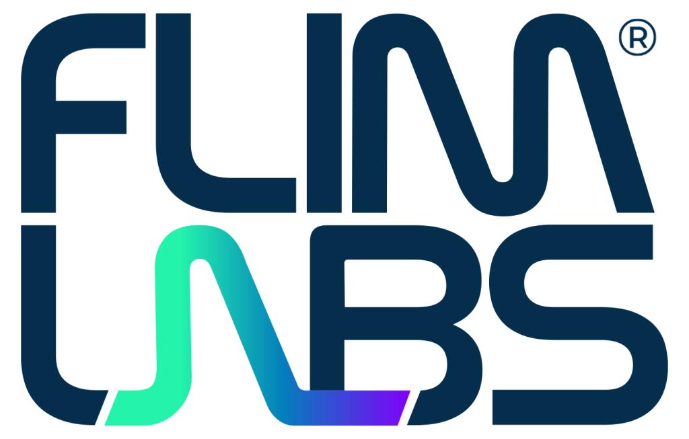

<a name="readme-top"></a>

<div align="center">
  <h1>Spectroscopy</h1>
</div>
<div align="center" style="padding: 0.5rem; border-radius: 5px">
  <a href="https://www.flimlabs.com/">
    
  </a>
</div>
<br>


<!-- TABLE OF CONTENTS -->
<details>
  <summary>Table of Contents</summary>
  <ol>
    <li>
      <a href="#about-the-project">About The Project</a>
      <ul>
        <li><a href="#built-with">Built With</a></li>
      </ul>
    </li>
    <li>
      <a href="#getting-started">Getting Started</a>
      <ul>
        <li><a href="#prerequisites">Prerequisites</a></li>
        <li><a href="#installation">Installation</a></li>
      </ul>
    </li>
    <li><a href="#usage-guides">Usage Guides</a></li>
    <li><a href="#license">License</a></li>
    <li><a href="#contact">Contact</a></li>
  </ol>
</details>

# About the project

Welcome to [FLIM LABS Spectroscopy](https://www.flimlabs.com/2026/products/spectroscopy/), a Python application designed to **analyze the fluorescence intensity decay as a function of time**. Facilitated by an underlying data processor developed in Rust, responsible for data retrieval from the hardware component, this application enables real-time data analysis and visualization. Whether your focus is on rigorous data analysis or dynamic visualizations, Spectroscopy serves as a flexible tool for the precise measurement and exploration of fluorescence intensity decay profile and lifetimes distributions.

### Built With

* [Python](https://www.python.org/)
* [PyQt6](https://pypi.org/project/PyQt6/)
* [pyqtgraph](https://www.pyqtgraph.org/)
* [matplotlib](https://pypi.org/project/matplotlib/)
* [numpy](https://numpy.org/)
* [scipy](https://scipy.org/)
* [flim-labs](https://pypi.org/project/flim-labs/)


<!-- GETTING STARTED -->

## Getting Started

If you want to use the application, the complete guide is the [User Manual](https://flim-labs.github.io/docs/spectroscopy/Spectroscopy-manual.pdf).

The instructions below are for technicians, developers, and IT staff who need to build, run, or debug the software from source.

To directly test the application, skipping the prerequisites and installation requirements you can download an installer at this [link](https://github.com/flim-labs/spectroscopy-py/releases/tag/v2.9) (_Note: you still need to have the FLIM LABS acquisition card_).

To get a local copy up and running follow these steps.

### Prerequisites

To be able to run this project locally on your machine you need to satisfy these requirements:

- Windows OS (>= Windows 10)
- 4GB RAM
- Multicore CPU
- Possess a [FLIM LABS acquisition card](https://www.flimlabs.com/products/data-acquisition-card/) to be able to acquire your data
- ZestSC3 drivers installed
- Python version <= 3.9

### Installation

1. Clone the repo
   ```sh
   git clone https://github.com/flim-labs/spectroscopy-py
   ```
2. Set the virtual environment in the root folder
   ```sh
   python -m venv venv
   ```
3. Activate the virtual environment:
   ```sh
   venv\Scripts\activate
   ```
4. Install the dependencies
   ```sh
   pip install -r requirements.txt
   ```
5. Run the project with GUI mode
   ```sh
   python spectroscopy.py
   ```

## Usage Guides

Navigate to the following links to view detailed application usage guides:

- [Spectroscopy GUI guide](./docs/v2.9/index.md)
- [Spectroscopy Data Export guide ](./docs/python-flim-labs/spectroscopy-file-format.md)
- [Spectroscopy Console guide](./docs/python-flim-labs/spectroscopy-console.md)

## Contact

FLIM LABS: info@flimlabs.com

Project Link: [FLIM LABS - Spectroscopy](https://www.flimlabs.com/2026/products/spectroscopy/)

<p align="right">(<a href="#readme-top">back to top</a>)</p>
